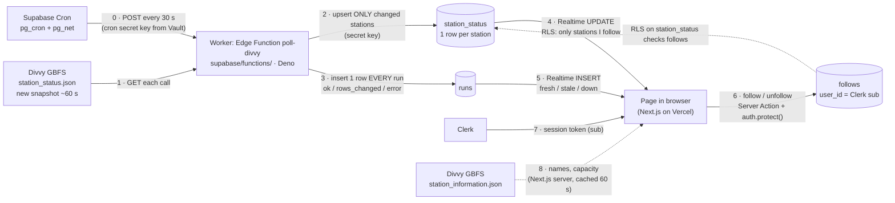

# DockCheck Live: data flow

Planned in step 3, before any worker, migration or Realtime code. Agreed 2026-10-28.

**Updated 2026-10-29:** the brief now runs the worker as a Supabase Edge Function called by Supabase Cron (Railway sign-ups are closed). Only the worker box and arrow 2's snapshot changed; the tables, Realtime and the page are the same.

> I follow Ellis & 58th as "Lab" → a worker on Supabase polls Divvy and saves only what changed → my open page ticks from 3 bikes to 2 on its own, and tells me how fresh that is.

## What each arrow sends, and what breaks if it changes

| # | From → to | What is sent | If it changed |
|---|---|---|---|
| 0 | Cron → worker | An HTTP POST every 30 s, with a Supabase secret key (kept in Vault) on the `apikey` header | Without the key the function answers 401 and logs nothing, so no `runs` rows: the page shows **stale**. If cron stops, same: **stale**. |
| 1 | Divvy → worker | `station_status.json`: per station `station_id`, `num_bikes_available`, `num_ebikes_available`, `num_docks_available`, `is_renting`, `is_returning`, `last_reported`; feed `last_updated`, `ttl` | Renamed fields or a new feed URL: the worker can't parse it, the run is logged `ok = false`, the page shows **down**. Counts stop updating but nothing wrong is saved. |
| 2 | Worker → `station_status` | Only stations whose counts or `is_renting`/`is_returning` differ from the last snapshot (read from `station_status` at the start of every call, because an Edge Function keeps nothing between calls). Never a row just because `last_reported` moved. | Comparing `last_reported` too: ~1,100 rewrites per run, and Realtime messages run out within days. Keeping a snapshot in the function's memory instead: two warm copies could disagree with the table and skip a real change. |
| 3 | Worker → `runs` | One row per run, even when 0 rows changed or the run failed: `started_at`, `finished_at`, `ok`, `rows_changed`, `error`, `feed_last_updated` | If the worker skipped the row on failure or on 0 changes, the page couldn't tell "nothing changed" from "worker dead", and stale/down would be wrong. |
| 4 | `station_status` → page | Realtime `UPDATE` for a station, sent only if RLS lets this person read it (they follow it) | Without the publication, the `select` grant, or the RLS policy, Realtime sends nothing and shows no error. If Clerk isn't a third-party provider in Supabase, `auth.jwt()->>'sub'` is empty and nobody can read anything. |
| 5 | `runs` → page | Realtime `INSERT` for each new run | Without it, "checked 20 s ago" only updates when a followed station changes, so a quiet station looks stale. |
| 6 | Page → `follows` | `station_id`, `nickname`, `need` (bike / dock); `user_id` defaults to the token's `sub` | Unfollowing removes the station from RLS, so its updates stop reaching that person. Without RLS on `follows`, people could see each other's choices. |
| 7 | Clerk → page | Session token whose `sub` is the Clerk user id, passed to the Supabase client for queries and Realtime | Wrong or missing token: RLS returns no rows and Realtime delivers nothing. |
| 8 | Divvy → Next.js server | Station names and capacity, for search and labels (as in A4, `src/lib/gbfs.ts`) | Changes rarely. If it fails, search breaks but live counts still arrive. |

## Tables

| Table | One row is | Written by | Read by | Realtime |
|---|---|---|---|---|
| `station_status` | a station's latest counts | worker only (secret key bypasses RLS) | signed-in users, only stations they follow | yes |
| `runs` | one worker poll | worker only | any signed-in user | yes |
| `follows` | one person following one station (replaces A4's `saved_stations`; `departures` and `checks` dropped) | the person, with RLS | the person, with RLS | no |

Signed-in users have no write grants on `station_status` or `runs`. Signed-out visitors (`anon`) have no grants at all.

## Freshness states on the page

Based on the newest `runs` row (worker polls every 30 s):

- **Loading**: no data from Supabase yet.
- **Fresh**: the newest run worked and finished less than 2 minutes ago (about 3 missed runs).
- **Stale**: no successful run in the last 2 minutes, so the worker is slow or stopped.
- **Down**: the newest run failed (`ok = false`).

## Decisions

1. The worker saves **all** stations (~2k rows), so it never reads anyone's follows.
2. RLS on `station_status` allows reading **only stations you follow**, so Realtime sends each person only their stations.
3. `saved_stations` becomes `follows`; `departures` and `checks` are not carried over.
4. The worker polls **every 30 s**. Divvy updates about every 60 s, so about half the runs log 0 changes. That is ~86,000 Edge Function calls a month, under a fifth of the free 500,000.
5. The worker is an **Edge Function `poll-divvy`** scheduled by **Supabase Cron** (brief update, 2026-10-29). It has `verify_jwt = false` (new secret keys aren't JWTs) and checks the caller's `apikey` against its own secret keys instead, so only cron can run it.
