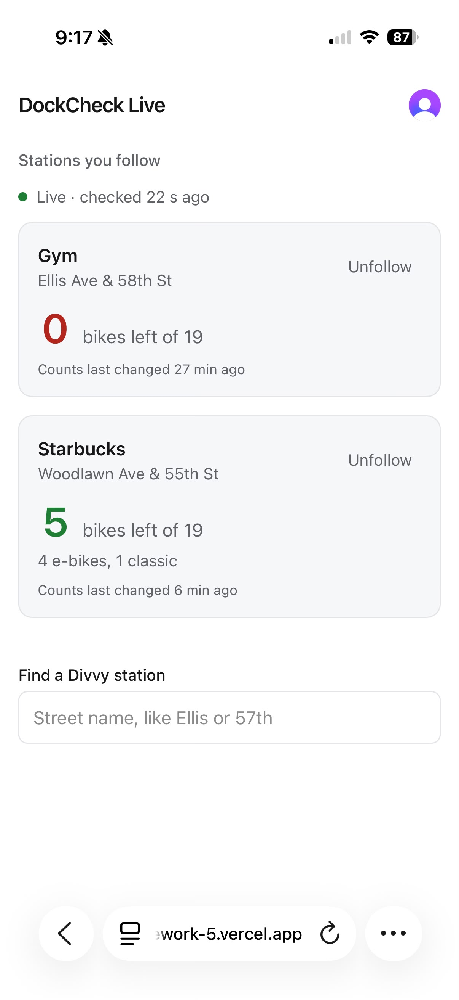

# Classmate test (2026-10-30, live site)

A classmate opened https://design-ship-build-homework-5.vercel.app on their phone, signed up, and followed two stations: "Gym" (Ellis Ave & 58th St) and "Starbucks" (Woodlawn Ave & 55th St).

Checked in Supabase afterwards (ids shortened):

| Clerk user | Follows | First follow (UTC) |
|---|---|---|
| `user_3LO…` (classmate, new account) | 2: Gym, Starbucks | 2026-10-30 02:16:53 |
| `user_3LJ…` (me) | 1: Law School | 2026-10-28 09:46:52 |

- Separate account, separate rows: RLS on `follows` keeps each person to their own choices (also proven by `e2e/isolation.spec.ts` against the live site).
- "Live · checked 22 s ago" on their phone is the Realtime `runs` insert from the cron worker reaching their page without a refresh.
